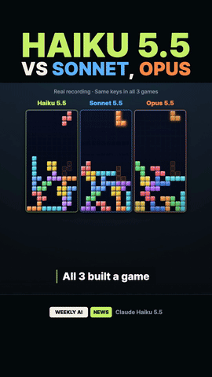
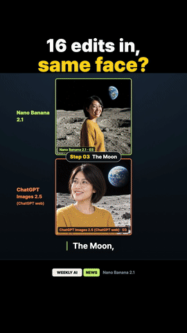
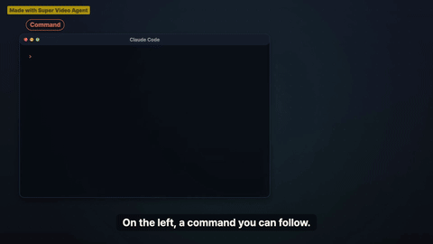

# Super Video Agent

[English](README.md) | 한국어 | [简体中文](README.zh-Hans.md) | [繁體中文](README.zh-Hant.md)

**PDF, 글, 주제 하나로 내레이션이 들어간 영상을 만듭니다. 모든 프레임을 코드로 그리고, 영상 생성 모델은 쓰지 않습니다.** 무료로 쓸 수 있고 소스가 공개된 Claude Code 플러그인입니다.

<p align="center"><a href="docs/gallery/3d-flight-en.mp4"></a></p>

▶ [이 스킬로 만든 영상 보기](https://www.youtube.com/@ww-w-ai)

Claude Code에서 **설치**:

```
/plugin marketplace add ww-w-ai/marketplace
/plugin install super-video-agent@ww-w-ai
```

그다음 말로 영상을 부탁하거나 `/super-video-agent`를 실행하면 됩니다. 다른 설치 방법: [설치](#설치).

한눈에 보기 (실측):

- 10쪽짜리 PDF 3개로 88초 숏폼: 모델 비용 약 $22, 모델 사용 시간 1시간. 이때 목소리는 로컬 모델로 만들었습니다.
- 40초짜리 3D 플라이트 영상: CPU에서 작업자 4개로 렌더 11~20분.
- 렌더가 끝난 뒤에도 목소리 한 줄, 장면 하나, 언어 하나만 바꾸고 나머지는 다시 렌더하지 않습니다.
- 목소리: 로컬 모델(Qwen3-TTS, Fish Speech, MeloTTS)은 내 컴퓨터에서 돌고 글자당 요금이 없습니다. 호스팅 서비스(Fish Audio, ElevenLabs, Typecast)는 글자 수나 텍스트 바이트 수만큼 요금이 나갑니다.

스킬 하나로 아래 종류의 영상을 만듭니다. 줄마다 방법이 적힌 파일을 달아 두었으니, 설치하기 전에
어떻게 동작하는지 먼저 읽어 볼 수 있습니다.

| 영상 종류 | 화면을 만드는 방법 | 방법 문서 |
|---|---|---|
| 쇼츠, 16:9 설명 영상, 1:1·4:5 피드 영상 | HTML 페이지 하나 안의 Canvas, SVG, Web Audio로 시간에 따라 그림 | [`references/pipeline.md`](skills/super-video-agent/references/pipeline.md) |
| 3D 영상 | 설치된 Blender가 테스트 렌더를 통과하면 Blender, 아니면 Three.js/WebGL | [`references/blender.md`](skills/super-video-agent/references/blender.md), [`references/3d.md`](skills/super-video-agent/references/3d.md) |
| 2.5D 사진 패럴랙스 | 사진 한 장을 깊이별 레이어로 잘라 카메라 한 번의 움직임으로 | [`references/parallax.md`](skills/super-video-agent/references/parallax.md) |
| 조립 과정 영상 | LDraw 모델 파일에서 조립 순서, 위치, 끼우는 방향을 뽑아냄 | [`references/assembly.md`](skills/super-video-agent/references/assembly.md) |
| 언어별 버전 | 그림은 한 번만 렌더하고, 언어마다 목소리와 자막을 그 위에 얹음 | [`scripts/dub.mjs`](skills/super-video-agent/scripts/dub.mjs) |

**Claude Opus 5.5에 PDF나 글, 주제 하나를 건네면 내 목소리나 고른 목소리로 읽어 주는 영상이 나옵니다.
유튜브 쇼츠, 16:9 설명 영상, 정사각형 피드 영상, 3D 영상, 움직이는 사진까지 만듭니다. 모든 프레임은
코드로 그리고, 다 만든 뒤에도 나머지는 그대로 둔 채 한 줄의 목소리, 한 장면, 한 언어만 바꿀 수
있습니다.** Super Video Agent는 Claude Code 플러그인으로, 2026년 9월 Reddit에 올라온 코드로 그린
영상들과 같은 방식으로 동작하면서, 그 영상들에는 없던 것을 더합니다. 어떤 언어든 쓸 수 있는 읽기 규칙과
발음 사전, 나머지는 건드리지 않는 렌더 후 수정, 어떤 화면 비율과 형식이든 만드는 자유, 비용에 맞춰 조정한
4단계 파이프라인, 대본에서 바로 연결되는 효과음 라이브러리입니다.

실제 작업으로 측정한 결과, 농구 스카우팅 리포트 PDF 3개(각 10쪽)로 88초짜리 숏폼을 만들었을 때
대본 $4.05, 대본 검토 $1.75, 영상 $16.34가 들었습니다. 약 $22에 모델 사용 시간 1시간입니다. 이때 목소리는
로컬 모델로 만들었고, 호스팅 목소리를 쓰면 그 서비스의 글자당 요금이 따로 붙습니다.

## 갤러리

아래 영상은 모두 이 스킬로 만들어 유튜브에 올린 것입니다. 클립을 누르면 영상으로 갑니다.

<table>
<tr>
<td align="center" width="33%"><a href="https://youtube.com/shorts/-Cxl0hHkjio"></a><br>3D 제품 광고 쇼츠: 폴더블 폰이 레이어별로 분해됩니다.</td>
<td align="center" width="33%"><a href="https://youtube.com/shorts/DoNDDrccoWA"></a><br>벤치마크 뉴스 쇼츠: AI 셋이 만든 테트리스가 나란히 달립니다.</td>
<td align="center" width="33%"><a href="https://youtube.com/shorts/OChlch1cUrc"></a><br>이미지 비교 쇼츠: 이미지 모델 둘이 같은 얼굴을 다시 그립니다.</td>
</tr>
</table>

<table>
<tr>
<td align="center" width="50%"><a href="https://www.youtube.com/watch?v=tjqvLeqh79w"></a><br>롱폼 뉴스 쇼: 3D 앵커가 진행하는 한 달 AI 소식 정리입니다.</td>
<td align="center" width="50%"><a href="https://youtu.be/AqV1cnGTEZY"></a><br>롱폼 튜토리얼: 왼쪽은 명령, 오른쪽은 완성된 쇼츠입니다.</td>
</tr>
</table>

**3D 플라이트** (이 페이지 맨 위): 40초짜리 쇼츠입니다. 카메라 한 번의 움직임으로 폰 화면 → 야간 도시 →
해저 케이블 → 데이터센터 → GPU 칩을 지나 답이 나타나는 폰 화면으로 돌아옵니다. Three.js/WebGL로 전부
코드로 그렸고, 영상·이미지 생성 모델은 쓰지 않았습니다.
▶ [영어 (MP4, 7.5 MB)](docs/gallery/3d-flight-en.mp4) · [한국어](docs/gallery/3d-flight-ko.mp4)

## 사용법

먼저 설치합니다([설치](#설치)). 그다음 Claude Code에서 Opus 5.5로 스킬을 부르고 원하는 것을 말하면 됩니다.

```
/super-video-agent 이 PDF로 유튜브 쇼츠 만들어 줘. 목소리는 me.wav에 있는 내 목소리로(녹음 내용: "…").
```

플러그인으로 설치하면 명령어가 `/super-video-agent:super-video-agent`로 나옵니다. `/super-video-agent`까지
치고 목록에서 고르면 됩니다. 명령어 없이 "영상 만들어 줘"처럼 말로 부탁해도 스킬이 알아서 시작됩니다.

스킬은 먼저 쇼츠 공식(훅을 먼저, 빠른 전개, 고정된 훅 제목이 있는 띠 형태 프레임)을 따를지 자유
스타일로 갈지 묻습니다. 화면 비율과 길이를 추론할 수 없으면 그것도 묻고, 어디서 멈춰 검토받을지, 다른
언어판을 같은 그림 위에 나중에 얹을지도 함께 묻습니다. 완성된 대본이나 스토리보드를 건네면, 그대로 쓸지
다시 짤지 물어봅니다.

### 3D 영상

"3D"라고만 말하면 스킬이 알아서 3D 방식으로 만듭니다.

```
/super-video-agent AI에게 엔터를 누르면 무슨 일이 일어나는지 게임 화면 같은 3D로 보여줘
```

Blender가 이미 설치돼 있으면 에이전트가 작은 EEVEE 테스트 렌더(`scripts/probe-blender.mjs`)를 돌려 보고,
통과하면 새 3D 영상에 Blender를 씁니다. 아니면 기본 Three.js 방식으로 진행합니다. Blender를 따로 설치할
필요는 없고, 스킬이 내려받지도 않습니다. `SVA_BLENDER_BIN`으로 테스트할 Blender 하나를 지정할 수 있습니다.
Three.js는 스킬에 포함되지 않으며, 그 방식을 쓸 때 에이전트가 영상 폴더에 설치합니다. 사용자가 렌더러를
지정하면 그 선택을 따르고, 기존 영상을 고칠 때는 원래 렌더러를 유지합니다.
자세한 내용: [`references/blender.md`](skills/super-video-agent/references/blender.md), [`references/3d.md`](skills/super-video-agent/references/3d.md).

### 사진, 조립 과정, 다른 언어

```
/super-video-agent 오프닝에서 이 사진을 2.5D로 움직여 줘. 출처는 화면에 표시하고
```

- **2.5D 사진 패럴랙스.** 사진 한 장을 깊이별 레이어 세 장으로 자르고(기본은 다각형 자르기, 알파 마스크와
  깊이 지도는 선택), 카메라 한 번의 움직임으로 가까운 레이어는 많이, 먼 레이어는 조금 움직입니다.
  움직이는 동안 가장자리가 드러날 레이어가 있으면 엔진이 알려 주고, 고칠 배율도 함께 알려 줍니다. 사진의
  출처, 만든 사람, 라이선스는 `FILM.md`에 남기고, 사진이 나오는 동안 읽을 수 있는 출처 표시를 화면에
  둡니다([`references/parallax.md`](skills/super-video-agent/references/parallax.md)).
- **조립 과정 영상.** LDraw 텍스트 형식의 모델 파일과 부품 폴더를 건네면 됩니다.
  `scripts/ldraw-bake.mjs`가 조립 순서, 부품마다의 위치, 끼우는 방향, 경로 검사를 뽑아냅니다. 빠진 부품이
  있으면 멈추고 그 부품 이름을 알려 줍니다. 스킬이 아는 방법 하나는 왼쪽에 설명서 페이지, 오른쪽에 3D
  모델을 두고 같은 단계 번호로 둘을 함께 움직이는 것입니다. 내레이션이 없는 영상은 무음 시계
  (`scripts/silent-clock.mjs`)로 돌아갑니다([`references/assembly.md`](skills/super-video-agent/references/assembly.md)).
- **그림 하나에 어떤 언어든.** 내 언어의 목소리를 먼저 만들어 시간을 정합니다. 그림은 자막 없이 한 번만
  렌더하고, 내 언어를 포함한 모든 언어를 `dub.mjs`로 그 위에 얹습니다. 길어진 줄은 최대 10%까지 빠르게
  읽히거나, 줄여 쓸 줄로 목록에 올라갑니다. 그림은 움직이지 않습니다.

### 이미지·영상 생성 모델 함께 쓰기

기본값은 이미지·영상 생성 모델 없이 모든 장면을 코드로 그립니다. 실사 배경, 제품 사진, 몇 초짜리 생성
영상처럼 더 풍부한 그림이 필요하면, 요청할 때 쓸 도구와 장면을 함께 적으면 됩니다.

아래는 **예시**입니다. 도구 이름과 경로는 직접 쓰는 것으로 바꿔 넣으세요. 스킬이 이 도구들을 기본으로
쓰거나 따로 연동해 두지는 않습니다.

```
/super-video-agent 이 덱으로 60초 홍보영상 만들어 줘. 첫 장면 배경은 Codex의 이미지 생성 기능을
이용해서, 제품 장면은 browser-use를 이용해서 Seedance로 5초짜리 영상을 만들어 넣어 줘.
```

도구마다 어떤 경로로 쓸지(CLI, API 키, 로그인된 브라우저)를 함께 적어 주세요. 직접 만든 파일을 건네도
됩니다. 어느 쪽이든 생성한 이미지·영상은 재료로 씁니다. 장면은 그 재료를 넣어 새로 구성하고, 파일마다
출처와 사용권을 `FILM.md`에 기록합니다.

## 왜 만들었나

2026년 9월, Reddit은 Claude Opus 5.5가 전부 코드로 만든 영상들로 가득 찼습니다. 리소그래프 스타일 기차
여행, SNES풍 애니메이션 전투, 졸라맨 유튜브 쇼츠 같은 것들이었습니다. 프롬프트는 짧았고, 모델이 스스로
도구를 골라 자기 렌더 결과를 확인했습니다.

저희도 저희 채널에서 시도해 봤고, 매번 같은 세 가지 벽에 부딪혔습니다.

1. **타이밍이 어긋납니다.** 추정으로 잡은 장면 길이는 실제 목소리가 대본을 읽으면 몇 초씩 밀립니다.
2. **목소리가 잘못 읽습니다.** 숫자, 이름, 영어 단어가 잘못 나오는데, 렌더링을 다 하고 나서야 알게 됩니다.
3. **한 군데만 고쳐도 전체를 다시 렌더링해야 합니다.** 한 줄만 바꿔도 목소리와 영상 전체를 다시 만들어야
   했습니다.

그래서 Super Video Agent를 만들었습니다. 이 세 가지 문제를 해결하면서도, 영상마다 디자인은 모델이 자유롭게
하도록 둔 스킬입니다.

## 주요 기능

Super Video Agent는 모델이 자유롭게 만들 수 있는 부분(직접 템플릿을 주지 않으면 정해진 틀이 없다는 것)은
그대로 두고, 모델 혼자서는 할 수 없는 다섯 가지를 더합니다.

1. [언어별 읽기 규칙](#1-언어별-읽기-규칙): 숫자, 이름, 영어 단어를 처음부터 제대로 읽습니다.
2. [다 만든 뒤에도 바뀐 곳만 고칩니다](#2-다-만든-뒤에도-바뀐-곳만-고칩니다): 한 줄, 한 장면, 한 언어만 바꾸고 나머지는 그대로 둡니다.
3. [어떤 화면 비율, 어떤 형식, 내 템플릿까지](#3-어떤-화면-비율-어떤-형식-내-템플릿까지): 쇼츠, 16:9, 정사각형, 3D, 사진 패럴랙스, 조립 과정, 시리즈 회차까지 만듭니다.
4. [4단계, 4개 세션, 단계별로 다른 노력 수준](#4-4단계-4개-세션-단계별로-다른-노력-수준): 88초 영상 하나에 약 $22가 들었습니다.
5. [대본에서 바로 연결되는 효과음](#5-대본에서-바로-연결되는-효과음): 단어에 맞춰 넣고, 어울리는지 점수를 매깁니다.

### 1. 언어별 읽기 규칙

합성 음성은 철자를 그대로 읽는데, 어떤 언어도 철자 그대로 발음되지 않습니다. Super Video Agent는 음성을
만들기 전에 대본에 실제로 읽는 형태를 미리 써넣습니다. 음성 엔진이 말할 수 있는 언어라면 어떤 언어든
됩니다. 숫자·단위·이름·약어는 모든 언어에 공통 점검표를 쓰고, 규칙 파일이 있는 언어는 철자에 드러나지 않는
소리까지 챙깁니다.

물론 유료 TTS 서비스에서는 굳이 이런 작업을 안 해도 될 수 있습니다. 하지만 이 규칙을 쓰면 저렴하거나 로컬
TTS 라이브러리를 써도 제대로 읽을 때가 많습니다.

| 언어 | 표기 | 읽는 형태 (`say`) | 규칙 |
|---|---|---|---|
| 영어 | `Opus 5.5`, `$16.34` | Opus five point five, sixteen dollars thirty-four | 버전과 금액은 말로 풀어 읽음 |
| 한국어 | `4.4`, `6월` | 사쩜사, 유월 | 소수점은 [쩜]으로 읽음; 월 표기는 고정형 |
| 일본어 | `3本`, `6本` | さんぼん, ろっぽん | 조수사에 따라 발음이 바뀜 |
| 중국어 | `2个`, `27.3%` | 两个, 百分之二十七点三 | 양사 앞에는 两; 퍼센트는 순서가 뒤바뀜 |

일부러 인용한 잘못된 읽기("X가 아니라 Y")도 소리 나는 대로 철자를 바꿔 씁니다. 음성 모델이 흔한 오독을
조용히 고쳐 버리기 때문입니다.

철자만으로는 해결 안 되는 단어는 `plan.json` 안의 발음 사전이 세 가지 방법을 지원합니다. 해당 언어의
문자로 다시 철자를 쓰거나, SSML(음성 합성 마크업 언어) `<phoneme>` 태그를 읽는 엔진에는 IPA(국제음성기호, 사전에 나오는 발음기호)를 주거나, 단어 자체를
바꿔 넣습니다. 한 항목이 그 단어가 쓰인 모든 줄에 적용되고, 자막에는 원래 철자가 그대로 남습니다.

```json
"pronounce": { "Nguyen": { "say": "Win", "ipa": "ˈŋwiən" } }
```

생성된 모든 줄은 다시 음성인식(STT)으로 받아써 확인합니다. 뚜렷하게 틀린 경우만 표시합니다. 절반 이상이
틀렸거나, 녹음 길이가 원래 줄 길이의 70% 미만이거나 140%를 넘는 경우입니다. STT 자체도 이름이나
동음이의어에서 틀리기 때문입니다. 표시는 들어 보라는 근거이지 자동으로 다시 만드는 신호가 아닙니다.
`voice.mjs --retry-flagged N`을 줄 때만 표시된 줄을 다시 만듭니다. 발음을 고쳐도 그 줄의 시간 자리는 그대로라
영상은 다시 렌더하지 않습니다.
([`references/readout.md`](skills/super-video-agent/references/readout.md), [`scripts/lib/pronounce.mjs`](skills/super-video-agent/scripts/lib/pronounce.mjs), [`scripts/lib/stt-compare.mjs`](skills/super-video-agent/scripts/lib/stt-compare.mjs), `scripts/voice.mjs --lines`)

### 2. 다 만든 뒤에도 바뀐 곳만 고칩니다

렌더가 끝난 영상도 잠겨 있지 않습니다. 내레이션 한 줄, 자막, 장면 하나, 언어, 오프닝과 엔딩을 따로따로
바꿀 수 있습니다. 나머지는 움직이지 않으니, 이미 확인한 부분은 그대로 남습니다.

| 바꾸고 싶은 것 | 실행하는 것 | 그대로 남는 것 |
|---|---|---|
| 내레이션 한 줄: 단어, 말투, 잘못 읽은 곳 | `voice.mjs --lines <id>`로 그 줄만 다시 녹음합니다. 소리가 나는 구간만 남기고 원래 자리에 맞춰 넣습니다. 최대 1.1배속까지 빠르게 하고, 뒤에는 최소 숨 쉴 틈을 남깁니다. 그래도 안 맞는 녹음은 거절되고 원래 클립이 남습니다 | 화면과 나머지 모든 줄 |
| 바뀐 줄을 앞뒤와 함께 듣기 | `preview-changes.mjs <reel> --lines <ids> --media <mixed.mp4>`가 바뀐 줄마다 앞 줄 끝부터 다음 줄 시작까지를 그림, 내레이션, 배경음을 합친 채로 잘라 줍니다 | 영상 |
| 자막 문구나 줄바꿈 위치 | `plan.json`을 고치고(`\|`로 줄바꿈 위치 지정) 그림을 먼저 만든 영상이면 `dub.mjs`를 다시 돌립니다 | 화면 |
| 장면 하나 | `render.mjs --only <shot>`이 그 장면만 렌더해 영상에 이어 붙입니다. `render.mjs --span <from>-<to>`는 그 초만 다시 렌더합니다. Blender 그림은 영향받는 프레임 구간만 다시 렌더합니다 | 나머지 모든 장면 |
| 다른 언어판 | `dub.mjs --lang <code>`가 그 언어의 목소리와 자막을 같은 그림 위에 얹습니다 | 한 번 렌더한 그림 |
| 다른 언어판에서 줄 사이 숨 쉴 틈 | `dub.mjs --min-gap <sec>`가 줄이 다음 줄에 붙는 구간만 그림과 효과음을 함께 늦춰 간격을 `<sec>`까지 벌립니다. 목소리 속도는 그대로입니다 | 목소리, 첫 프레임과 마지막 프레임, 다른 언어판 |
| 시간을 다시 맞춘 목소리 트랙 | `render.mjs --narration <wav> --timings <json>`이 원래 목소리 대신 그 트랙으로 렌더합니다 | `voice/narration.wav`와 `voice/timings.json` |
| 업로드용 오프닝과 엔딩 | `join.mjs`가 붙이고, 이음새마다 음량·딸깍 소리 위험·프레임 일치를 알려 줍니다 | 본편 영상 |

수정 요청이 여러 번에 걸쳐 오면, 요청을 전부 `FILM.md`의 목록 하나에 상태(완료, 남음, 뒤 요청으로 바뀜)와
함께 쌓아 둡니다. 매번 그 목록 전체를 보고 계획하고 확인하므로, 새 수정이 앞서 고친 것을 되돌리지 않습니다.

갤러리의 3D 영상으로 잰 결과입니다. 전체 렌더 한 번에 11~20분이 걸렸습니다. 검토 뒤 목소리·자막 수정 8건
(바뀐 단어, 끝을 올려야 하는 질문, 한 단어만 따로 떨어진 자막 줄)을 3D 그림을 다시 렌더하지 않고
반영했습니다. 2D 영상은 바뀐 장면만 몇 분 안에 다시 렌더합니다.
([`scripts/voice.mjs`](skills/super-video-agent/scripts/voice.mjs), [`scripts/dub.mjs`](skills/super-video-agent/scripts/dub.mjs), [`scripts/render.mjs`](skills/super-video-agent/scripts/render.mjs), [`scripts/preview-changes.mjs`](skills/super-video-agent/scripts/preview-changes.mjs), [`scripts/join.mjs`](skills/super-video-agent/scripts/join.mjs))

이미 만든 음성은 [음성 후보정·교체 가이드](skills/super-video-agent/guides/audio-editing.md)에 따라 쉼과 속도를 로컬에서 조절하고, 화면을 다시 렌더하지 않고 교체할 수 있습니다.

### 3. 어떤 화면 비율, 어떤 형식, 내 템플릿까지

- **어떤 화면 비율이든.** 네 가지 크기는 옵션 하나로 바로 시작합니다. 9:16(쇼츠·릴스·틱톡), 16:9(유튜브·
  발표), 1:1과 4:5(피드)입니다. 그 밖의 크기도 됩니다. 렌더러가 페이지에 적힌 가로·세로 크기를 그대로 쓰기
  때문입니다.
- **어떤 스타일이든.** 쇼츠 공식(훅으로 시작, 빠른 전개, 제목이 고정된 띠 형태 화면), 자유 스타일(모델이
  이 영상에 맞게 디자인), 또는 직접 가져온 템플릿(레이아웃, 브랜드 색과 폰트, 시리즈 타이틀 카드) 중에
  고릅니다. 템플릿을 주면 모든 장면을 그 안에서 만듭니다.
- **어떤 종류의 영상이든.** PDF나 글로 만드는 설명 영상, 소개 자료로 만드는 홍보 영상, 코드로 그린 뉴스
  데스크나 실시간 점수 화면, Blender나 WebGL 3D 영상, 2.5D 사진 패럴랙스, 모델 파일로 만드는 조립 과정
  영상, 오프닝과 엔딩이 붙은 시리즈 회차, 그림 하나를 같이 쓰는 여러 언어판까지 만듭니다.
- **계속 나아지고 있습니다.** 일부러 더 어려운 영상에 하나씩 도전하고, 그걸 만드느라 필요했던 것을
  스킬에 다시 넣습니다. 갤러리의 영상들이 그 시험대입니다.

### 4. 4단계, 4개 세션, 단계별로 다른 노력 수준

각 단계는 앞 단계가 남긴 파일만 읽으므로, 단계마다 새 세션에서 각자의 노력 수준(effort)으로 돕니다.
88초짜리 영상으로 측정한 결과입니다.

| 단계 | 산출물 | 노력 수준 | 비용 |
|---|---|---|---|
| 대본 | `plan.json`, `FILM.md` (출처가 달린 사실) | xhigh | $4.05 |
| 검토 | 6회 검토를 거쳐 잠근 `plan.json` | low | $1.75 |
| 음성 | 측정된 `timings.json`이 들어 있는 `voice/` | low | $0 (이 작업에서는 로컬 모델) |
| 영상 | `reel.html`, `out/final-<timestamp>.mp4` | xhigh | $16.34 |

"노력 수준(effort)"은 Claude가 답하기 전에 얼마나 오래 생각할지 정하는 설정으로, `low`부터 `max`까지
있습니다. 높을수록 비용과 시간이 더 들기 때문에, 꼭 필요한 단계에만 높게 씁니다.

어느 단계에 필요한지 보려고, 같은 영상의 대본을 모든 노력 수준으로 써 보고 대본 속 숫자를 출처 PDF와
하나하나 대조했습니다.

| 노력 수준 | 비용 | 시간 | 출처와 다른 숫자 |
|---|---|---|---|
| low | $2.21 | 2분35초 | 0건 |
| medium | $2.13 | 1분57초 | 0건 |
| high | $3.40 | 6분11초 | 0건 |
| xhigh | $4.05 | 6분05초 | 0건 |
| max | $8.04 | 23분14초 | 0건 |

- 모든 수준에서 사실 오류가 없었습니다. 비용이 중요하면 대본도 낮은 수준으로 써도 됩니다. `max`는
  `medium`보다 비용이 약 4배, 시간이 12배 들었습니다.
- 검토 단계는 `low`로 돌리는데도 대본 세션이 놓친 두 가지를 잡아냈습니다. 두 가지로 읽힐 수 있는 문장
  하나, 그리고 음성이 두 번 읽을 뻔한 단위 하나입니다.

영상이 끝나면 스킬이 단계마다 걸린 시간, 세션, 비용, 토큰과 요청마다 기록한 음성 합성 사용량을 출력합니다
(`scripts/runner/cost-report.mjs`). 자세한 내용: `SKILL.md`의 "Four stages, four sessions" 절.

### 5. 대본에서 바로 연결되는 효과음

목록이 시작될 때 "띵동", 핵심 문장에 "쿵". 이런 짧은 효과음이 쇼츠를 살리는데, 편집기에서 하나하나
손으로 넣으면 오래 걸립니다. 여기서는 모델이 대본을 쓰면서 같이 넣습니다.

1. **효과음 라이브러리를 준비해 둡니다.** 가진 효과음 파일(과 짧은 리액션 클립)을 한 폴더에 모으고,
   `catalog.json`에 각 파일이 무엇인지, 상업적으로 써도 되는지를 적어 둡니다.
2. **모델이 줄마다 어울리는 효과음을 고릅니다.** 키워드로 라이브러리를 검색하고, 그 줄의 어느 순간에
   넣을지 정합니다. 줄의 시작, 끝, 또는 특정 단어("*딱*이라는 단어에서")입니다.
3. **렌더러가 정확히 그 순간에 섞어 넣습니다.** 효과음은 길이에 맞게 잘리고, 끝이 부드럽게 줄어들고,
   큰 파일이 목소리를 덮지 않게 음량이 맞춰집니다. 짧은 영상 클립은 같은 시간축에 맞춰 한 프레임씩
   그려집니다.

라이선스도 알아서 확인합니다. 상업적 사용 표시가 없는 파일은, 따로 허용하지 않는 한 공개용 영상에서
빠집니다. 효과음 팩은 대부분 자체 이용 조건이 있어서, 이 저장소에는 효과음 파일이 들어 있지 않습니다.

라이브러리가 없어도 소리는 납니다. 스킬이 효과음을 코드로 직접 만들기 때문입니다
([`scripts/engine/reel-audio.js`](skills/super-video-agent/scripts/engine/reel-audio.js)). 클릭, 타자, 쿵, 휙, 뽁, 틱, 띵, 퉁 같은 소리를 노이즈와 발진기로
렌더할 때 바로 만들어 냅니다. 파일도 없고 라이선스를 확인할 필요도 없습니다. 같은 큐는 늘 같은 소리를
내서, 다시 렌더해도 똑같이 나옵니다.
([`scripts/assets.mjs`](skills/super-video-agent/scripts/assets.mjs), [`references/pipeline.md`](skills/super-video-agent/references/pipeline.md), "Asset library")

넣은 효과음은 모두 어울리는지 점수를 매깁니다. 화면에서 일어나는 일의 크기·재질·속도에 맞는지, 이
영상의 분위기에 속하는지를 봅니다. 먼저 소리마다 길이·최대 음량·어택·밝기·음높이 변화를 재고,
`TYPESAFE_API_KEY`가 있으면 TypeSafe AI의 Jev가(1점 만점에 0.8 통과), 없으면 지금 모델이 채점표로
판정합니다. 통과하지 못한 소리는 이 영상에 맞게 새로 만들고, 최대 세 번까지 다시 봅니다.
([`scripts/sfx-cards.mjs`](skills/super-video-agent/scripts/sfx-cards.mjs), [`references/sound.md`](skills/super-video-agent/references/sound.md) §7)

## 그 밖의 기본 기능

### 목소리

- **목소리를 먼저 만들고, 화면이 목소리를 따라갑니다.** 장면을 하나도 만들기 전에 내레이션부터 만들고
  길이를 잽니다. `voice/timings.json`에 줄과 단어마다 시작 시각이 기록되고, 모든 장면이 이 시각에 맞춰
  움직입니다. 그래서 자막이 목소리보다 먼저 나가는 일이 없습니다([`scripts/voice.mjs`](skills/super-video-agent/scripts/voice.mjs)).
- **내 목소리로, 또는 원하는 엔진으로.** 5~15초 녹음으로 내 목소리를 내 컴퓨터에서 복제하거나(Qwen3-TTS,
  Fish Speech), 호스팅 서비스(Fish Audio, ElevenLabs, Typecast), MeloTTS, 직접 녹음한 파일을 쓸 수
  있습니다. Fish Audio(S2)와 ElevenLabs(v3/v4)는 읽는 문장에 `{confident}`, `{pause}` 같은 표시도
  받습니다. 표시는 모델마다 그 모델의 태그로 바뀌고, 자막에는 나오지 않습니다. 줄마다 목소리를 따로 줄 수
  있어서 한 영상에 화자를 여럿 둘 수 있습니다.
- **목소리 하나는 한 번에 읽고, 줄별로 자릅니다.** 어느 제공자든 한 목소리의 모든 줄을 요청 한 번으로
  만들고 스킬이 줄별로 잘라 쓰므로, 영상 내내 목소리 결이 하나로 이어집니다.
- **줄마다 다시 들어 봅니다.** 음성을 만든 뒤 음성인식이 줄마다 받아써서 대본과 비교하고, 파형 검사가
  잘린 시작, 잘린 끝, 딸깍 소리를 찾습니다. 표시된 줄은 id와 함께 알려 주니 어느 줄을 들어 볼지 압니다.
- **줄마다 말끝을 검사합니다.** 넣은 클립을 다듬기 전 원본 녹음과 비교해, 마지막 음절이 20 ms 이상
  사라졌으면 그 줄을 `END_CUT`으로 표시합니다. 고치는 방법은 원본 녹음을 다시 넣는 것이고, 새로 합성하지
  않습니다.
- **로컬 복제 모델도 말끝이 깔끔합니다.** 로컬 음성 모델은 마지막 음절을 자주 자릅니다. 그래서 줄마다
  뒤에 짧은 단어를 하나 더 읽게 하고(촬영장의 슬레이트처럼), 그 앞의 쉼에서 잘라 냅니다. 말끝이
  자연스럽게 끝납니다.
- **말투는 귀로 고릅니다.** 전체 내레이션을 만들기 전에 오프닝 줄을 2~4가지 말투로 녹음해
  나란히 들려줄 수 있습니다(`voice.mjs --takes`). 고른 말투(`--pick`)가 모든 줄의 말투가 됩니다.

### 대본

- **자연스럽게 이어지는 내레이션.** 줄마다 쉬는 길이를 따로 정합니다. 다음 줄이 같은 생각을 이어 가면
  짧게, 장면이 바뀌면 길게 쉽니다. 문장 끝을 이어지게 맺고 쉼표는 강조할 때만 써서, 글을 읽는 것처럼
  들리지 않게 합니다.
- **숨 쉴 틈은 계획에서 정합니다.** `meta.minBreathMs`(기본값 500 ms)가 줄 사이 가장 짧은 쉼입니다.
  스포츠 중계처럼 빠른 말은 `meta.gapMs`를 250 안팎으로, 최소 쉼을 200 ms 안팎으로 둘 수 있고, 줄의
  `pauseAfterMs`로 정한 침묵은 적힌 그대로 지킵니다.
- **목소리를 만들기 전에 5단계 검토.** 출처 대비 사실, 이야기 구성, 말로 하는 표현, 읽는 방식, 마지막
  통독 순서입니다. 대본을 확정한 뒤에 목소리를 한 번만 만듭니다.

### 화면

- **언제 그려도 같은 프레임.** 페이지는 시간만 보고 프레임을 그립니다(`seek(t)`). 같은 시각이면 늘 같은
  픽셀이 나오므로, 미리보기와 다시 렌더한 영상과 검사 결과가 모두 일치합니다.
- **앱 버튼을 피하는 글자.** 자막은 쇼츠와 틱톡이 버튼과 제목을 올리는 자리를 피합니다(1080×1920 기준
  x 80–888, y 200–1470). 그림은 여전히 화면 전체를 채웁니다.
- **읽는 곳에서 끊기는 자막.** 자막은 먼저 문장부호에서 나누고, 그다음 줄 길이가 고르게 나눕니다.
  한 단어만 남으면 옆 줄에 붙입니다. 대본에 `|`를 넣으면 그 자리에서 직접 끊을 수 있고, 목소리는 이
  표시를 읽지 않습니다.
- **자막 대비를 잽니다.** 렌더와 모든 언어판이 줄마다 자막과 뒤 그림의 대비를 WCAG 비율로 알려 줍니다
  (언어판은 `dub/<code>/contrast.json`).

### 검사와 결과물

- **영상이 스스로 검사합니다.** 렌더가 끝나면 [`scripts/review.mjs`](skills/super-video-agent/scripts/review.mjs)가 콘택트 시트를 만들고, 멈춘 화면,
  칸을 넘친 글자, 음량, 제때 나오지 않은 효과음, 소리가 비는 구간을 검사합니다. 결과는 수치로 나오고,
  직접 들어 볼 만한 시각도 함께 알려 줍니다.
- **렌더할 때마다 따로 남깁니다.** 렌더마다 시각이 붙은 파일이 새로 생기고, `out/final.mp4`는 늘 가장
  최근 파일을 가리킵니다. 영상을 열어 둔 플레이어가 새 렌더 때문에 깨지지 않고, 버전끼리 비교할 수도
  있습니다.

## 설치

Node 22+, `PATH`에 있는 FFmpeg, Playwright용 Chromium이 필요합니다.

### 스킬 설치

**Claude Code 플러그인으로 설치:**

```
/plugin marketplace add ww-w-ai/marketplace
/plugin install super-video-agent@ww-w-ai
```

처음 사용할 때 스킬이 자신의 폴더 안에 Node 의존성과 Chromium을 설치하고(`node scripts/setup.mjs`),
이어서 FFmpeg를 확인합니다.

**Codex 플러그인으로 설치:**

```bash
codex plugin marketplace add ww-w-ai/marketplace
codex plugin add super-video-agent@ww-w-ai
```

새 버전으로 올릴 때는 `codex plugin marketplace upgrade ww-w-ai`를 먼저 실행한 뒤 같은 `add` 명령을 다시
실행합니다.

**독립 스킬로 설치**(Claude Code 또는 Codex):

```bash
git clone https://github.com/ww-w-ai/super-video-agent /tmp/super-video-agent
cp -R /tmp/super-video-agent/skills/super-video-agent ~/.claude/skills/super-video-agent   # Codex: ~/.codex/skills/super-video-agent
node ~/.claude/skills/super-video-agent/scripts/setup.mjs
```

### 음성과 음성 확인

음성 제공자를 하나 이상 설정해야 합니다. 하나도 없으면 음성 단계가 멈추고 무엇을 설정해야 하는지 알려
줍니다. 로컬 제공자는 내 컴퓨터에서 돌고, 호스팅 제공자는 그 서비스의 서버에서 돌며 API 키가 필요합니다.
복제는 본인 목소리나 허락받은 목소리만 하세요.

Qwen3-TTS로 내 목소리를 로컬에서 복제하려면:

1. Python 환경을 만들고(Qwen3-TTS가 권장하는 Python 3.12) 음성 모델을 설치합니다.

   ```bash
   python3.12 -m venv ~/.venvs/sva-voice
   ~/.venvs/sva-voice/bin/pip install -U qwen-tts
   ```

2. 첫 영상을 만들 때 Hugging Face에서 모델을 내려받습니다. 1.7B는 약 4.2 GB, 0.6B는 약 2.3 GB입니다.
3. 내 목소리를 5~15초 녹음합니다. 문장이 끝나는 곳에서 녹음을 끝내고, 말한 내용을 그대로 적어 둡니다.
   스킬은 이 둘을 `meta.voice.refAudio`와 `refText`로 씁니다.

음성 확인은 Apple silicon macOS에서 mlx-whisper로 줄마다 받아씁니다. 먼저 `small` 모델로 보고, 첫
받아쓰기가 미심쩍은 줄만 `turbo` 모델로 다시 봅니다.

```bash
python3.11 -m venv ~/.venvs/sva-stt
~/.venvs/sva-stt/bin/pip install mlx-whisper
```

그다음 `setup.mjs --stt-models`를 한 번 실행해(독립 스킬 설치라면
`node ~/.claude/skills/super-video-agent/scripts/setup.mjs --stt-models`) 두 모델을 내려받습니다(수백 MB에서
몇 GB). 다른 기기에서는 `SVA_STT_ENGINE=groq`와 `GROQ_API_KEY`로 호스팅 Whisper API를 쓸 수 있고, 이때만
음성이 내 컴퓨터 밖으로 나갑니다. 둘 다 없으면 확인을 건너뛴다는 안내만 나옵니다.

두 Python의 위치를 스킬에 알려 줍니다. `~/.zshenv`(또는 쓰는 셸의 설정 파일)에 넣습니다.

```bash
export SVA_QWEN3_PYTHON=~/.venvs/sva-voice/bin/python
export SVA_STT_PYTHON=~/.venvs/sva-stt/bin/python
```

Qwen3-TTS 모델:

| 모델 | 내려받는 용량 | 참고 |
|---|---|---|
| `Qwen/Qwen3-TTS-12Hz-1.7B-Base` (기본값) | 약 4.2 GB | 발음이 더 또렷하고 말끝이 덜 뭉개짐 |
| `Qwen/Qwen3-TTS-12Hz-0.6B-Base` | 약 2.3 GB | 더 가벼움, 덜 또렷함 |

모든 영상에 적용하려면 `SVA_QWEN3_MODEL`, 한 영상에만 적용하려면 `meta.voice.model`에 적습니다.
NVIDIA GPU가 있는 컴퓨터라면 `SVA_QWEN3_DEVICE=cuda`로 둡니다.

스킬이 읽는 변수 전체:

| 변수 | 가리키는 곳 | 필요한 경우 |
|---|---|---|
| `SVA_QWEN3_PYTHON` | `import qwen_tts`가 되는 Python ([Qwen3-TTS](https://github.com/QwenLM/Qwen3-TTS)) | 로컬 음성 복제 |
| `SVA_QWEN3_MODEL` | Qwen3-TTS 모델 이름 (기본값 `Qwen/Qwen3-TTS-12Hz-1.7B-Base`) | 모든 영상에 다른 모델을 쓸 때. plan의 `meta.voice.model`이 있으면 그쪽이 우선 |
| `SVA_FISH_DIR` | `fish-speech/`(체크아웃)와 `.venv-tts/`(그 Python)가 있는 폴더 | 로컬 Fish Speech |
| `SVA_MELO_PYTHON` | MeloTTS가 설치된 Python | 로컬 MeloTTS |
| `SVA_QWEN3_DEVICE`, `SVA_FISH_DEVICE` | `mps`(기본값), `cuda` 또는 `cpu` | Apple 외 기기 |
| `FISH_AUDIO_API_KEY`(또는 `FISH_API_KEY`), `FISH_AUDIO_VOICE_ID` | 본인의 Fish Audio 키와 보이스 | 호스팅 Fish Audio |
| `ELEVENLABS_API_KEY`, `ELEVENLABS_VOICE_ID` | 본인의 ElevenLabs 키와 보이스 | 호스팅 ElevenLabs |
| `TYPECAST_API_KEY`, `TYPECAST_VOICE_ID` | 본인의 Typecast API 키와 보이스(`tc_…`) | 호스팅 Typecast |
| `SAY_VOICE` | macOS `say` 목소리 이름(기본값 `Yuna`) | macOS에서 `--provider say`로 실행할 때만 |
| `SVA_STT_ENGINE` | `mlx`(기본값) 또는 `groq` | 음성 확인 |
| `SVA_STT_PYTHON` | `mlx-whisper`가 설치된 Python | 음성 확인(설정 안 하면 안내와 함께 건너뜀) |
| `SVA_STT_MODEL`, `SVA_STT_MODEL_RECHECK` | 첫 확인 모델과 재확인 모델(기본값 `small`, `turbo`) | 선택 사항 |
| `GROQ_API_KEY` | 본인의 Groq 키 | `SVA_STT_ENGINE=groq`로 음성 확인할 때 |
| `SVA_BLENDER_BIN` | Blender 실행 파일 하나의 절대 경로. 이것 하나만 테스트함 | 선택 사항, 3D 영상 |
| `SVA_ASSET_LIB` | 효과음 라이브러리 폴더(기본값 `~/.super-video-agent/library`) | 선택 사항 |

**설정하는 곳** — 모두 환경변수로 설정합니다. 쓰는 환경에 맞는 곳 하나를 고르세요.

| 환경 | 설정하는 곳 |
|---|---|
| Claude Code (모든 OS) | `~/.claude/settings.json`의 `env`: `{"env": {"ELEVENLABS_API_KEY": "..."}}` |
| macOS · Linux, zsh | `~/.zshenv`에 `export ELEVENLABS_API_KEY="..."` |
| Linux, bash | `~/.bashrc`에 `export ELEVENLABS_API_KEY="..."` |
| Windows (PowerShell) | `setx ELEVENLABS_API_KEY "..."` 실행 후 터미널을 새로 엽니다 |

### 어떤 음성 모델을 쓸까

`--provider`를 주지 않으면 `voice.mjs`가 설정된 것 가운데 이 순서로 고르고, 무엇을 썼는지 알려 줍니다.
직접 녹음한 파일(`voice/in/`), 참조 목소리가 있는 Qwen3-TTS, Fish Audio, ElevenLabs, Typecast, MeloTTS
순서입니다. Fish Speech와 macOS `say`는 이름을 지정할 때만 씁니다. 합성 요청은 모두 `tts-usage.jsonl`에
기록됩니다(보낸 글자 수, 돌아온 길이, 제공자가 알려 준 비용).

| 모델 | 어디서 도나 | 비용 | 속도 | 설정 |
|---|---|---|---|---|
| Qwen3-TTS 1.7B / 0.6B | 내 컴퓨터 | 글자당 요금 없음 | 이 중 가장 느림 | `SVA_QWEN3_PYTHON` + 내 목소리 5~15초 녹음 |
| Fish Speech | 내 컴퓨터 | 글자당 요금 없음 | 여기서는 재지 않음 | `SVA_FISH_DIR` |
| MeloTTS | 내 컴퓨터 | 글자당 요금 없음 | 빠름. 한국어 화자 하나 | `SVA_MELO_PYTHON` |
| Fish Audio | Fish Audio 서버 | 텍스트의 UTF-8 바이트 수만큼. 기본 모델 `s2.1-pro-free`는 Fish Audio가 제공하는 동안 무료(2026-11-30까지로 발표) | 한 줄에 몇 초 | `FISH_AUDIO_API_KEY`, `FISH_AUDIO_VOICE_ID` |
| ElevenLabs | ElevenLabs 서버 | 태그를 포함한 글자 수만큼 | 한 줄에 몇 초 | `ELEVENLABS_API_KEY`, `ELEVENLABS_VOICE_ID` |
| Typecast | Typecast 서버 | 글자 수만큼 | 한 줄에 몇 초 | `TYPECAST_API_KEY`, `TYPECAST_VOICE_ID` |

#### Qwen3-TTS

- **어떤 모델인가.** Qwen 팀이 공개한 음성 모델입니다. 짧은 녹음 하나로 목소리를 따라 하기 때문에
  영상이 내 목소리로 말합니다.
- **직접 설치하는 것.** 저장소에는 이 모델을 부르는 코드만 들어 있습니다. `qwen-tts` 패키지는 위 안내대로
  직접 설치하고, 모델은 첫 영상을 만들 때 Hugging Face에서 받습니다.
- **속도.** 짧은 줄 10개(음성 20초)에 2분 54초 걸렸습니다. Apple Silicon Mac에서 모델을 불러오는
  시간과 음성인식 검사까지 포함한 값입니다.
- **녹음이 결과를 정합니다.** 문장이 끝나는 곳에서 자른 5~15초짜리 깨끗한 녹음과, 그 녹음의 정확한
  대본이 필요합니다. 단어 중간에서 자른 녹음을 썼더니 그 음절이 새로 만든 21줄 중 11줄 앞에 붙어
  나왔습니다. 문장 끝에서 자르자 없어졌습니다.
- **1.7B와 0.6B.** 1.7B가 단어가 더 또렷하고 끝이 뭉개지는 일이 적었습니다. 0.6B는 더 가볍습니다.
- **말투.** 말투가 고른 편이라 감정을 강하게 드러내지 않습니다. 실험에서 질문 끝을 한 번도 올리지
  않았습니다(10번 중 0번).

#### Fish Audio

- **어떤 서비스인가.** 호스팅 음성 서비스입니다. 서비스에 있는 목소리를 골라 쓰거나, API 키만으로 내
  목소리를 복제할 수 있습니다.
- **가격.** 입력 텍스트의 UTF-8 바이트 수만큼 요금이 나갑니다. 기본 모델 `s2.1-pro-free`는 무료로
  제공되고(2026-11-30까지로 발표), `s2.1-pro`가 같은 모델의 유료판입니다.
- **말투 표시.** `{confident}`·`{excited}` 같은 말투 표시를 따릅니다. 따로 표시하지 않으면 쇼츠를
  밋밋하게 읽기 때문에, Fish로 만드는 9:16 영상에는 `{confident}`가 기본으로 붙습니다.
- **질문 끝.** 질문 끝을 거의 올리지 않았습니다. 잴 수 있었던 23번 중 3번이었고, 어떤 태그를 붙여 봐도
  달라지지 않았습니다.

#### ElevenLabs

- **어떤 서비스인가.** 기본 목소리가 많고 그 자리에서 목소리를 복제할 수 있는 호스팅 음성 서비스입니다.
  기본 모델은 `eleven_multilingual_v2`이고, `eleven_v3`와 `eleven_v4`는 오디오 태그를 받습니다.
- **가격.** 오디오 태그를 포함한 글자 수만큼 요금이 나갑니다. 라이브러리 목소리는 유료 요금제에서만 API로 쓸 수 있습니다.
- **키 권한.** 권한을 제한한 API 키는 음성 합성 권한이 있어야 합니다. 목소리 목록을 보려면
  `voices_read` 권한도 필요합니다. 이 권한이 없으면 기본 목소리 ID를 `ELEVENLABS_VOICE_ID`에 직접
  넣으세요.
- **단어 시간.** 단어마다 언제 나오는지 모델이 알려 줍니다.
- **영상 전체를 한 번에 읽습니다.** 한 줄씩 보냈을 때는 `eleven_v3`가 한국어 줄 끝을 18번 중 9번 잘랐고,
  끝에 `[pause]`를 붙여 한 번에 읽혔을 때는 25번 중 0번이었습니다.

#### Typecast

- **어떤 서비스인가.** 캐릭터 목소리가 많은 호스팅 음성 서비스입니다. 모델은 `ssfm-v30`입니다.
- **가격.** 글자 수만큼 요금이 나갑니다.
- **감정.** 문장 안 태그 대신 요청마다 감정 프리셋 하나를 씁니다. `meta.voice.emotion`(`normal`,
  `happy`, `sad`, `angry`, `whisper`, `toneup`, `tonedown`, 기본값 `normal`)입니다. 줄은 `?`와 `!`를
  그대로 두므로 모델이 문장부호를 보고 억양을 정합니다. 자기 `emotion`이 있는 줄은 그 프리셋으로 따로
  만듭니다. 실측해 보니 `toneup`은 문장 끝만이 아니라 문장 전체의 음높이를 올립니다.
- **단어 시간.** 단어마다 언제 나오는지 모델이 알려 줍니다.

#### 질문 끝 억양 — 무엇을 쟀나

영어와 한국어에서 예/아니오 질문은 보통 마지막 음절이 올라가야 질문처럼 들립니다("준비됐어?↗").
음성 모델은 이걸 평평하게 또는 내려 읽는 일이 많아서, 질문이 평서문처럼 들립니다. 한국어 질문 두 개,
"다음 토큰은 뭘까?"와 "여기가 엔비디아 세상인가?"를 모델마다 여러 번 녹음하고, 마지막 음절이 바로 앞
음절보다 2반음 넘게 높은지 쟀습니다.

| 모델 | 마지막 음절이 올라간 녹음 |
|---|---|
| ElevenLabs `eleven_v3` | 10번 중 5번 |
| ElevenLabs `eleven_multilingual_v2` | 10번 중 4번 |
| Fish Audio `s2.1-pro-free` | 잴 수 있었던 23번 중 3번 |
| Qwen3-TTS 1.7B | 10번 중 0번 |

끝이 내려가는 게 늘 틀린 것은 아닙니다. 무엇·어디·왜로 묻는 질문은 내려가는 경우도 흔합니다. 그래서
스킬은 이걸 판정하지 않습니다. 직접 들어 보고, 마음에 드는 녹음이 나올 때까지 그 줄만 다시
녹음하세요(`voice.mjs --lines <id>`).

재는 방법, 녹음별 수치, 한계: [TTS 네 모델의 질문 억양과 발음 정확도](docs/research/tts-models.ko.md)

### 폰트

영상 속 글자는 전부 페이지가 직접 그립니다. 그래서 폰트도 파일로 영상과 함께 다닙니다. 새 릴을 만들
때마다 폰트 파일을 `assets/fonts/`에 복사해 두고, 미리보기와 최종 렌더가 같은 파일을 씁니다.

- **기본값: [Pretendard](https://github.com/orioncactus/pretendard).** SIL Open Font License로
  무료이고, 한글과 영문이 한 가족에 들어 있습니다. 컴퓨터에 한 번 설치해 두면 새 릴마다 자동으로
  복사됩니다. 한글 손글씨 폰트가 설치되어 있으면 손글씨 메모용으로 함께 복사됩니다.
- **원하는 폰트 무엇이든.** 모델에게 어떤 폰트를 쓸지 말하면 됩니다("제목은 Noto Serif로", "우리
  브랜드 폰트로"). 그 폰트 파일을 릴에 복사해서 씁니다. 영상에 써도 되는 라이선스인지는 확인해 주세요.
- **폰트가 하나도 없으면.** 시스템 기본 산세리프체로 그립니다. 렌더는 되지만, 만든 컴퓨터에 깔린 폰트에
  따라 모양이 달라집니다.

### 효과음 라이브러리 (선택)

가진 효과음 파일과 `catalog.json`을 `~/.super-video-agent/library`에 두거나, 다른 폴더에 두고
`SVA_ASSET_LIB`로 알려 줍니다. `SVA_ASSET_LIB`를 정하면 그쪽이 먼저입니다(형식: [`references/pipeline.md`](skills/super-video-agent/references/pipeline.md)의 "Asset library"). 라이브러리가 없어도
스킬이 코드로 만드는 효과음은 그대로 납니다.

## 크레딧

Super Video Agent는 아래 Reddit 게시물들에서 출발했습니다. Claude Opus 5.5에게 주제와 작업할 여지만
주면 무엇을 해내는지 보여 준 글들입니다. 만드신 분들께 감사드립니다.

| 게시물 | 보여 준 것 |
|---|---|
| [Opus 5.5 is insane at making videos](https://www.reddit.com/r/singularity/comments/1worlfs/opus_55_is_insane_at_making_videos/) — u/Silver-Chipmunk7744, r/singularity | 한 쪽짜리 이야기 프롬프트로 코드가 렌더한 SNES풍 애니메이션 전투 |
| [I asked Opus 5.5 to create an animation on how LLMs work](https://www.reddit.com/r/claude/comments/1wnxppc/i_asked_opus_55_to_create_an_animation_on_how/) — u/cody-fifth-door, r/claude | 23단어 프롬프트로 만든 내레이션 패러디 설명 영상 |
| [Opus 5.5 One Shot Video Generation](https://www.reddit.com/r/ClaudeAI/comments/1wnh4fn/opus_55_one_shot_video_generation/) — u/AzorAhai1TK, r/ClaudeAI | 화면과 소리를 모두 코드로, 도구 선택은 모델에게 |
| [Opus 5.5 made six films, each one drawn under the rules of an old physical medium](https://www.reddit.com/r/ClaudeAI/comments/1wp6opy/opus_55_made_six_films_each_one_drawn_under_the/) — u/datathe1st, r/ClaudeAI | 영상마다 작업 노트를 남기고 다음 작업으로 이어 감 |
| [I gave Claude Opus 5.5 an MP3 and a few lines of art direction. It built a 50-shot painted music video entirely in code, with no video or image model](https://www.reddit.com/r/singularity/comments/1wp6zp8/i_gave_claude_opus_55_an_mp3_and_a_few_lines_of/) — u/DigitalDaydreamers1, r/singularity | 짧은 메모로 이끈 50컷 뮤직비디오 |
| [Opus 5.5 creates a train journey drawn entirely in JavaScript](https://www.reddit.com/r/ClaudeAI/comments/1wnkvys/opus_55_creates_a_train_journey_drawn_entirely_in/) — u/mshort3, r/ClaudeAI | 시간만 보고 그리는 영상, 콘택트 시트로 검토 |
| [Opus 5.5 made this whole YouTube Short in one HTML file. No images, no video editor, just code](https://www.reddit.com/r/ClaudeCode/comments/1wolkjy/opus_55_made_this_whole_youtube_short_in_one_html/) — u/quitpornio, r/ClaudeCode | 목소리가 먼저: 잰 줄 시간에 맞춰 화면이 움직임 |

런타임 의존성과 각 라이선스는 [THIRD-PARTY-NOTICES.md](THIRD-PARTY-NOTICES.md)에 정리되어 있습니다.

[DubDubDub Corp.](https://ww-w.ai)가 만들었습니다 · [Super Video Agent License 1.0](LICENSE): 내 영상을 만드는 데는 상업용을 포함해 자유롭게 쓰고 고칠 수 있습니다. 스킬을 되팔기, 유료 강의·상품에 끼워 팔기, 호스팅 서비스로 제공하기, 재배포하기는 허용하지 않습니다. 1.3.3 이하 버전은 Apache-2.0으로 남습니다.
